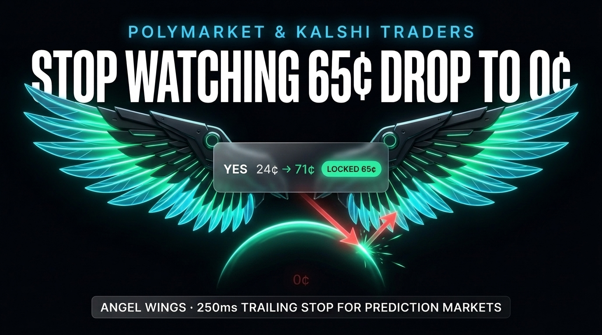
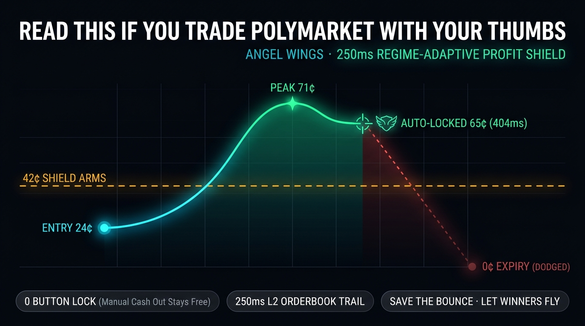

# Angel Wings — 250ms Non-Locking Trailing Profit Shield for Polymarket & Kalshi

> **Locks the exit, not your trade.**  
> Stop watching 24¢ → 71¢ bounces round-trip back to 0¢ because neither Polymarket nor Kalshi offers a native trailing profit stop that leaves your phone's Cash Out button free.



### Don't Want to Run Node.js or Keep a Laptop Awake 24/7?
> **Angel Wings Cloud Co-Pilot (Waitlist Open):** Non-custodial, trade-only API key (zero withdrawal permissions), 24/7 offline protection even when your cell signal drops, SMS/Telegram alerts, and 1-click presets.  
> Open [docs/waitlist.html](docs/waitlist.html) to preview the hosted Co-Pilot waitlist page.

---

## Why Angel Wings Exists

Manual prediction-market traders on 5-minute, 15-minute, and 1-hour markets face two brutal traps:
1. **No Native Trailing Stop:** Resting a GTC limit sell freezes your shares so your phone app's manual **Cash Out** button gets locked.
2. **Human Reaction Latency & Dropped Signal:** In fast binary snapbacks, a `24¢ → 71¢` spike can dump back to `0¢` in seconds — or while your phone loses signal inside a store.

**Angel Wings solves both:**
- **Zero Resting GTC Sell Orders:** Polls live L2 order books at `250ms` (4x/sec). Your mobile Cash Out button remains 100% unlocked at all times.
- **Downside-Only Profit Shield:** NEVER sells at a loss (`curBid >= avgCost + 4¢` hard invariant).
- **Regime-Adaptive Step-Ratchet (`v2`):** Lets real winners fly (`24¢ → 71¢ → 88¢`) while ratcheting protective floors underneath (`36¢ → 52¢ → 64¢ → 78¢`).



---

## Adaptive Trailing Tiers (`src/policy.js` — Integer-Cent Exact)

**Global Invariants:**
- Every tier evaluates in **rounded integer cents** (`Math.round(px * 100)`) so thresholds and logs match 100%.
- **Minimum Profit Trigger Gate:** Trigger bid must be `>= entry + 4¢` (note: IOC limit sells submit 1¢ under bid for immediate fill, so exchange fees/slippage apply).
- **High-Altitude Gate:** Step-ratchet `64¢` / `78¢` locks require `peak >= entry + 12¢`.

| Tier | Entry Price | Arms At | Trail / Floor | Purpose |
| :--- | :--- | :--- | :--- | :--- |
| **Micro-Lotto (`0A`)** | `<= 12¢` | `>= 15¢` | `4¢` peak trail (needs `bid >= entry + 4¢`) | Protects low-cost lottery bounces |
| **Theta-Pin (`0B`)** | `13¢ – 25¢` | `>= 42¢` | `6¢` trail / `36¢` floor (`4¢` / `38¢` in pin stall) | Prevents 2x+ bounces from dying to `0¢` |
| **50s Runner (`0C`)** | `26¢ – 45¢` | `>= 55¢` | `6¢` trail / `52¢` floor | Ignores early chop; rides `60¢–90¢` |
| **Step-Ratchet (`1`)** | Any | `>= 70¢` / `>= 84¢` | `64¢` / `78¢` floor lock (`peak >= entry + 12¢`) | Locks high-altitude runners automatically |
| **Directional (`2`)** | `> 45¢` | `entry + 15¢` | `8¢` trail (`5¢` if `<= 60s` left or pin stall) | Guards conviction trades into the bell |

---

## Quickstart (Core Library & Verification)

This repository ships the **auditable open-source core policy & single-flight IOC guardian engine** (`src/policy.js`, `src/guardian.js`) ready to plug into your own Polymarket US or Kalshi venue adapter.

```bash
git clone https://github.com/jw83252014-creator/angel-wings.git
cd angel-wings
npm test          # Runs all 19 policy + single-flight IOC guardian tests
npm run scrub     # Verifies zero embedded keys or private strings
```

## Security & Disclaimer
- **Trade-Only Keys:** Use strictly **trade-only, zero-withdrawal** API keys. Note that trade-only keys still carry order-execution authority (they can buy/sell inside your account, though they cannot withdraw funds).
- **Risk Tool, Not a Guarantee:** Binary prediction markets can gap rapidly through IOC bids during thin liquidity or macro prints. Always test with `live: false` (`DRY_RUN`) first.
- Licensed under [MIT](LICENSE).
